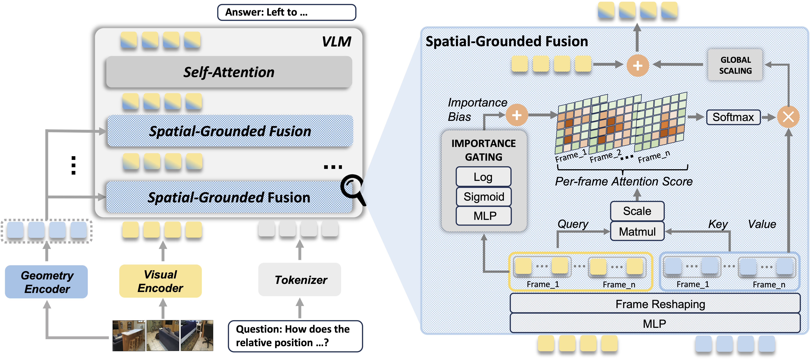
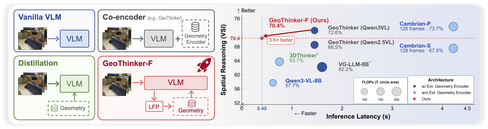
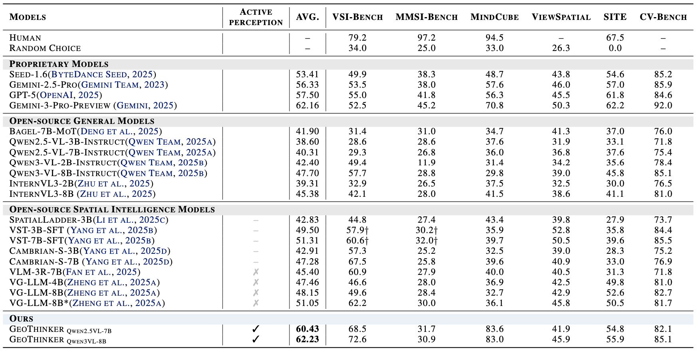
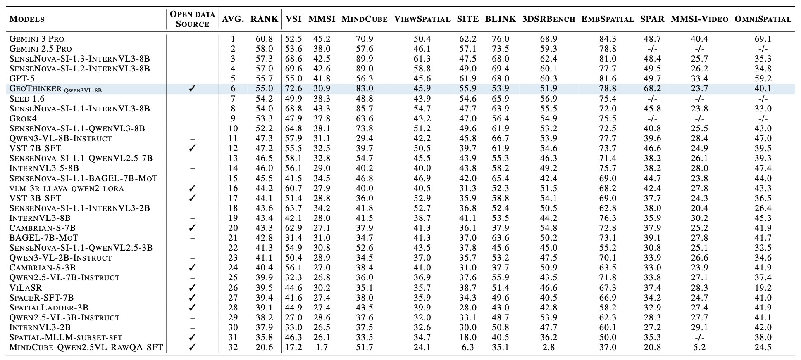
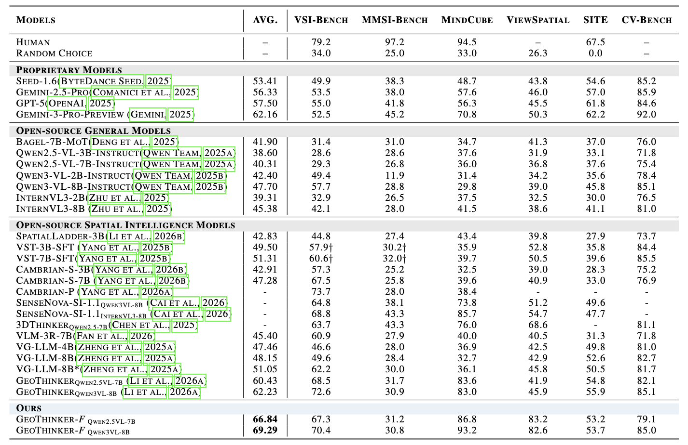
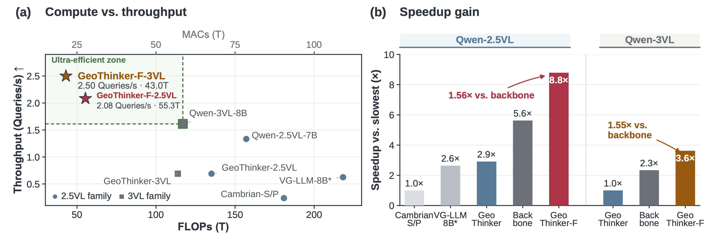
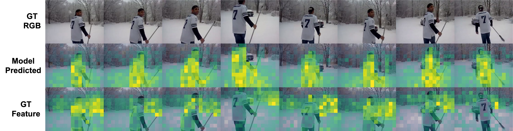
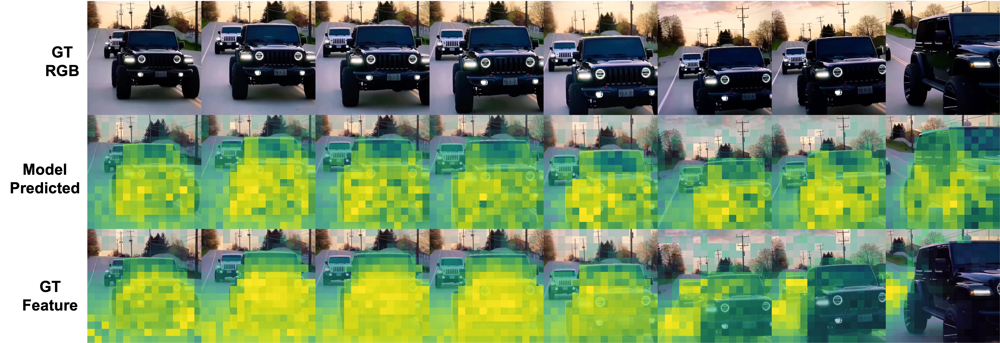

# GeoThinker & GeoThinker-F

**Active geometry integration and endogenous predictive world representations for spatial intelligence.**

<div align="center">
  <a href="https://arxiv.org/abs/2602.06037"></a>
  <a href="https://li-hao-yuan.github.io/GeoThinker/"></a>
  <a href="https://huggingface.co/lihy285/GeoThinker"></a>
  <a href="https://huggingface.co/lihy285/GeoThinkerF"></a>
</div>

This repository supports two related works with a shared training and evaluation workflow:

| Work | Main idea | External geometry encoder at inference |
|---|---|---|
| **GeoThinker** | Selectively retrieve task-relevant geometric evidence through Spatial-Grounded Fusion (SGF). | Yes |
| **GeoThinker-F** | Predict current geometry and future semantics inside the VLM, then integrate these priors through Spatial-Grounded Temporal (SGT) Fusion. | No |

**Contents:** [Overview](#overview) · [Results](#results) · [Feature visualizations](#feature-visualizations) · [Setup](#setup) · [Models](#models) · [Datasets and data preparation](#datasets-and-data-preparation) · [Training](#training) · [Evaluation](#evaluation) · [Citation](#citation) · [Acknowledgements](#acknowledgements) · [License](#license)

## News

- **2026-10-14:** GeoThinker-F code & model weights released.
- **2026-07-05:** GeoThinker is accepted to ICML2026.
- **2026-02-04:** GeoThinker model weights released.
- **2026-02-02:** GeoThinker code released.

## Overview

### GeoThinker

**[Thinking with Geometry: Active Geometry Integration for Spatial Reasoning](https://arxiv.org/abs/2602.06037)**

Haoyuan Li<sup>*</sup>, Qihang Cao<sup>*</sup>, Tao Tang, Kun Xiang, Zihan Guo, Jianhua Han, Hang Xu, Xiaodan Liang<sup>‡</sup>

<sup>*</sup> Equal contribution. <sup>‡</sup> Corresponding author.

GeoThinker shifts geometry integration from passive fusion to active perception. The VLM selectively retrieves task-relevant geometric evidence according to its reasoning needs.

<p align="center">
  
</p>

<details>
<summary><strong>✨ Architecture Overview</strong></summary>

GeoThinker represents a paradigm shift in how Multimodal Large Language Models (MLLMs) understand the 3D world, moving from <span style="text-decoration: underline;">passive fusion</span> to <span style="text-decoration: underline;">active perception</span>. GeoThinker empowers the model to selectively query the geometric information it needs to solve a specific task.

1. **Dual-Encoder Processing**

   The system begins by processing input video frames through two specialized paths.

   - A 2D vision encoder extracts high-level semantic features (the "what" of the scene).
   - A 3D visual geometry encoder (VGGT) captures fine-grained spatial structures and inter-frame dependencies (the "where" and "how" of the 3D space).

2. **Spatial-Grounded Fusion (SGF)**

   Instead of mixing features at the start, GeoThinker uses the Spatial-Grounded Fusion (SGF) module to manage interactions.

   - SGF employs frame-strict cross-attention, ensuring that visual tokens only look at geometric cues from the corresponding frame to maintain spatial consistency.
   - An Importance Gating module predicts a localized bias, allowing the model to focus on salient geometric features like object boundaries while ignoring redundant noise like empty floors or walls.

<p align="center">
  
  <br><em>GeoThinker architecture.</em>
</p>

</details>

### GeoThinker-F

**GeoThinker-F: Endogenous Predictive World Representations for Fast Spatial Intelligence**

Haoyuan Li<sup>*†</sup>, Qihang Cao<sup>*</sup>, Huanyuan Zhou, Xin Hu, Sijia Chen, Zihan Guo, Kun Xiang,
Yunshuang Nie, Tao Tang, Xinlong Zheng, Jia-Wang Bian, Xianming Liu, Xiaodan Liang<sup>‡</sup>

<sup>*</sup> Equal contribution. <sup>†</sup> Work done as an intern at XPeng Motors. <sup>‡</sup> Corresponding author.

<!-- GeoThinker-F paper URL: -->
<!-- GeoThinker-F project page URL: -->

GeoThinker-F predicts current geometry and future semantics from the VLM's own intermediate hidden states, enabling spatial reasoning without executing an external geometry encoder at inference.

<p align="center">
  
  <br><em>GeoThinker-F generates its own geometry priors at inference.</em>
</p>

<details>
<summary><strong>✨ Architecture Overview</strong></summary>

1. **Latent Frame Prediction (LFP)**

   Lightweight heads attached to intermediate VLM layers predict two complementary representations:

   - Current-frame geometry features, supervised by a geometry expert during pretraining.
   - Next-frame semantic features, supervised by semantic representations of the following frame.

2. **Decoupled Two-Stage Training**

   - **Stage 1: LFP pretraining.** Freeze the VLM backbone and train the prediction heads against geometry-expert and next-frame semantic targets.
   - **Stage 2: self-driven tuning.** Remove the external geometry encoder and tune the model for spatial reasoning using its self-predicted priors.

3. **Spatial-Grounded Temporal (SGT) Fusion**

   Separate geometry and temporal branches selectively integrate the predicted representations. Layer-interleaved injection separates the two streams across VLM layers, while learnable residual scaling controls their contribution to the reasoning states.

<p align="center">
  
  <br><em>Stage 1: LFP pretraining. Stage 2: self-driven tuning with SGT Fusion.</em>
</p>

</details>

## Results

### Spatial intelligence

The following table reports the **scaled-regime results** from the GeoThinker-F manuscript. The average is taken over the six listed benchmarks; vanilla-regime results are shown separately below.

| Method | Backbone | Average | VSI-Bench | MMSI-Bench | MindCube | ViewSpatial | SITE | CV-Bench |
|---|---|---:|---:|---:|---:|---:|---:|---:|
| GeoThinker | Qwen2.5-VL-7B | 60.43 | 68.5 | **31.7** | 83.6 | 41.9 | 54.8 | 82.1 |
| GeoThinker | Qwen3-VL-8B | 62.23 | **72.6** | 30.9 | 83.0 | 45.9 | **55.9** | **85.1** |
| GeoThinker-F | Qwen2.5-VL-7B | 66.84 | 67.3 | 31.2 | 86.8 | **83.2** | 53.2 | 79.1 |
| GeoThinker-F | Qwen3-VL-8B | **69.29** | 70.4 | 30.8 | **93.2** | 82.6 | 53.7 | 85.0 |

In the **vanilla regime**, GeoThinker-F Qwen2.5-VL-7B achieves **50.7** on VSI-Bench, compared with **50.5** for GeoThinker Qwen2.5-VL-7B, using the reported controlled training setup.

<details>
<summary>Original GeoThinker result figures</summary>

GeoThinker's reported VSI-Bench result reaches 72.6.

<p align="center">
  
</p>

GeoThinker's original README reports an EASI score of 55.0.

<p align="center">
  
</p>

</details>

<details>
<summary>GeoThinker-F result figures</summary>

<p align="center">
  
</p>

</details>

### Inference efficiency

With Qwen3-VL-8B, the reported GeoThinker-F system reduces latency from **1.45 s to 0.40 s**, a **3.6× speedup** over GeoThinker, while achieving **70.4** on VSI-Bench. These measurements include spatial token compression as well as removal of the external geometry encoder.

| GeoThinker-F backbone | Throughput | FLOPs | Speedup over the corresponding VLM backbone |
|---|---:|---:|---:|
| Qwen2.5-VL-7B | 2.08 queries/s | 55.3 T | 1.56× |
| Qwen3-VL-8B | 2.50 queries/s | 43.0 T | 1.55× |

<p align="center">
  
</p>

The manuscript measures latency on a PPU-ZW810E 96 GB accelerator with FP16 precision, batch size 1, and a fixed 32-frame input. It reports the average over 100 measured runs after 10 warm-up runs. The speedup ratios in the figure use the baselines identified within each backbone family.

## Feature visualizations

The following examples compare the **geometry features predicted by the VLM's LFP heads** with the **VGGT feature targets**. Each figure shows the input RGB frames, model-predicted features, and reference feature targets, from top to bottom.

<p align="center">
  
</p>

<p align="center">
  
</p>

## Setup

Run the commands below from the root of this repository. The training stack uses Python 3.10, PyTorch, DeepSpeed, and Flash Attention; use an accelerator environment compatible with those dependencies.

```bash
conda create -n geothinker python=3.10
conda activate geothinker
pip install -e .
```

Install the Transformers version for your training backbone:

| Backbone | Training version | Requirements file |
|---|---|---|
| Qwen2.5-VL | 4.50.0 | [transformers-qwen25.txt](requirements/transformers-qwen25.txt) |
| Qwen3-VL | 4.57.0 | [transformers-qwen3.txt](requirements/transformers-qwen3.txt) |

```bash
# Qwen2.5-VL training environment
pip install -r requirements/transformers-qwen25.txt
```

```bash
# Qwen3-VL training environment
pip install -r requirements/transformers-qwen3.txt
```

Use separate environments when switching between the two training backbones. The original GeoThinker evaluation setup uses Transformers 4.57.0 for both backbones.

## Models

The released backbones include [Qwen2.5-VL-3B-Instruct](https://huggingface.co/Qwen/Qwen2.5-VL-3B-Instruct), [Qwen2.5-VL-7B-Instruct](https://huggingface.co/Qwen/Qwen2.5-VL-7B-Instruct), and [Qwen3-VL-8B-Instruct](https://huggingface.co/Qwen/Qwen3-VL-8B-Instruct). GeoThinker uses [VGGT-1B](https://huggingface.co/facebook/VGGT-1B) at inference. GeoThinker-F uses VGGT as a Stage 1 teacher and does not execute it during inference.

### GeoThinker checkpoints

| Training regime | Backbone | Model |
|---|---|---|
| Vanilla | Qwen2.5-VL-3B | [GeoThinker-VGGT-Vanilla-Qwen25VL-3B](https://huggingface.co/lihy285/GeoThinker/tree/main/GeoThinker-VGGT-Vanilla-Qwen25VL-3B) |
| Vanilla | Qwen2.5-VL-7B | [GeoThinker-VGGT-Vanilla-Qwen25VL-7B](https://huggingface.co/lihy285/GeoThinker/tree/main/GeoThinker-VGGT-Vanilla-Qwen25VL-7B) |
| Scaled | Qwen2.5-VL-7B | [GeoThinker-VGGT-Scaled-Qwen25VL-7B](https://huggingface.co/lihy285/GeoThinker/tree/main/GeoThinker-VGGT-Scaled-Qwen25VL-7B) |
| Scaled | Qwen3-VL-8B | [GeoThinker-VGGT-Scaled-Qwen3VL-8B](https://huggingface.co/lihy285/GeoThinker/tree/main/GeoThinker-VGGT-Scaled-Qwen3VL-8B) |

### GeoThinker-F checkpoints

| Training regime | Backbone | Model |
|---|---|---|
| Vanilla | Qwen2.5-VL-7B | [GeoThinkerF-Qwen25VL7B-vanilla](https://huggingface.co/lihy285/GeoThinkerF/tree/main/GeoThinkerF-Qwen25VL7B-vanilla) |
| Scaled | Qwen2.5-VL-7B | [GeoThinkerF-Qwen25VL7B-scaled](https://huggingface.co/lihy285/GeoThinkerF/tree/main/GeoThinkerF-Qwen25VL7B-scaled) |
| Scaled | Qwen3-VL-8B | [GeoThinkerF-Qwen3VL8B-scaled](https://huggingface.co/lihy285/GeoThinkerF/tree/main/GeoThinkerF-Qwen3VL8B-scaled) |

Download a complete checkpoint directory, including its model config, weights, tokenizer, and processor files, and set `MODEL_PATH` to that directory in the examples below.

## Datasets and data preparation

### Training regimes

Both works include vanilla and scaled training settings. The exact data mixture depends on the work and stage.

| Dataset | Use | Source |
|---|---|---|
| SPAR-7M | Vanilla and scaled spatial instruction data; the vanilla subset contains approximately 234K examples. | [SPAR-7M](https://huggingface.co/datasets/jasonzhango/SPAR-7M) |
| LLaVA-Video-178K, LLaVA-Hound split | Vanilla video instruction data and GeoThinker-F Stage 1 pretraining; approximately 64K examples in the sampled subset. | [LLaVA-Video-178K](https://huggingface.co/datasets/lmms-lab/LLaVA-Video-178K) |
| VLM-3R | Scaled spatial and spatiotemporal instruction data. | [VLM-3R-DATA](https://huggingface.co/datasets/Journey9ni/VLM-3R-DATA) |
| VSI-590K | Scaled spatial instruction data. | [VSI-590K](https://huggingface.co/datasets/nyu-visionx/VSI-590K) |
| MindCube | Scaled spatial intelligence instruction data. | [MindCube](https://huggingface.co/datasets/MLL-Lab/MindCube) |
| Cambrian-S-3M subset | Approximately 430K general video samples in the scaled setting. | [Cambrian-S-3M](https://huggingface.co/datasets/nyu-visionx/Cambrian-S-3M) |
| PhysGame / PhysVLM-SFT | Additional instruction data in the original GeoThinker scaled mixture. | [PhysVLM-SFT](https://huggingface.co/PhysGame/PhysVLM-SFT) |
| OmniSpatial | Additional spatial reasoning data used by GeoThinker-F. | [OmniSpatial](https://huggingface.co/datasets/qizekun/OmniSpatial) |

Register any additional datasets before including them in `DATASETS`.

For the original SPAR subset, follow the official data preparation and discard navigation questions. When using the ScanNet-based VLM-3R annotations with SPAR media, exclude ARKitScenes records whose corresponding images are not available in that media set.

### Downloads

- **Vanilla annotations:** [VG-LLM-Data](https://huggingface.co/datasets/zd11024/VG-LLM-Data).
- **Scaled GeoThinker annotations:** [GeoThinker training data](https://huggingface.co/lihy285/GeoThinker/tree/main/train).
- **LLaVA-Hound media:** [ShareGPTVideo media](https://huggingface.co/datasets/ShareGPTVideo/train_video_and_instruction/tree/main/train_300k).
- **SPAR media:** [SPAR-7M](https://huggingface.co/datasets/jasonzhango/SPAR-7M). The same ScanNet media can serve the corresponding VLM-3R annotations.
- **Other media:** Download from the dataset links above. [data/data_links.txt](data/data_links.txt) lists selected Cambrian-S media sources.

### Folder structure

Place annotation files under `data/train` and media under `data/media`. A representative layout is:

```text
data/
├── train/
│   ├── spar_234k.json
│   ├── llava_hound_64k.json
│   ├── llava_hound_64k_32frame.json
│   ├── vlm3r_vsi_205k_32frames.json
│   ├── vlm3r_vst_132k_32frames.json
│   ├── vsi_590k_32frame.json
│   ├── mindcube_10k.json
│   ├── phygames_140k.json
│   └── cambrian_s_3m_clean_32frame.json
├── media/
│   ├── spar/
│   ├── llava_hound/
│   └── <other dataset media>/
└── evaluation/
    └── <benchmark annotations>/
```

The filenames above match entries in the current dataset registry. The original broader folder listing is available in [data/data_tree.txt](data/data_tree.txt); use the registry's filenames for training.

Configure each dataset entry in [src/qwen_vl/data/__init__.py](src/qwen_vl/data/__init__.py):

- `annotation_path` points to the JSON or JSONL annotation file.
- `data_path` is the media root prepended to relative image/video paths. It can be empty when annotation paths are absolute.
- `DATASETS` selects registered dataset names, such as `spar_234k` or `llava_hound_64k_32frame`.

The current GeoThinker-F Stage 2 defaults also list `omnispatial_7k` and `DSR_13k_32frame`, which are not yet present in the shared registry. Add their annotation/media entries to use that full mixture. The Stage 2 examples below explicitly select names already registered.

<details>
<summary>Example video annotation</summary>

```json
{
  "id": "23230678_1",
  "conversations": [
    {
      "from": "human",
      "value": "<video>\nWhat happens in the middle of the video?"
    },
    {
      "from": "gpt",
      "value": "A handgun is displayed on a surface covered with documents."
    }
  ],
  "data_source": "llava_hound",
  "video": "llava_hound/frames/23230678"
}
```

</details>

<details>
<summary>Example multi-view SPAR annotation</summary>

```json
{
  "id": "scene0012_01_1661",
  "conversations": [
    {
      "from": "human",
      "value": "<image>\n<image>\n<image>\nAssume the depth of box (red point) is 2.0. How much deeper or shallower is chair (green point) relative to table (blue point), measured in meters? Provide a numeric response with just one value."
    },
    {
      "from": "gpt",
      "value": "1.5"
    }
  ],
  "images": [
    "spar/scannet/images/scene0012_01/image_color/2626.jpg",
    "spar/scannet/images/scene0012_01/image_color/3321.jpg",
    "spar/scannet/images/scene0012_01/image_color/133.jpg"
  ],
  "spar_info": "{\"red_point\": [[395, 89]], \"blue_point\": [[494, 620]], \"green_point\": [[878, 737]], \"point_img_idx\": [[0, 2, 1]], \"type\": \"depth_prediction_oo_mv\"}"
}
```

</details>

For scaled training, prepare the matching frame-sampled annotations and media. Pre-extracting video frames can reduce decoding overhead during training.

## Training

### Select a work

The training entry point uses `--geometry_method` to select the implementation:

| Work | `geometry_method` | `geo_inject_version` |
|---|---|---|
| GeoThinker | `geothinker` | `v2_flash` |
| GeoThinker-F | `geothinker_f` | `v3_2` |

The launchers already set these values. Model paths, datasets, output folders, learning rates, and distributed settings can be configured through environment variables.

```bash
export NPROC_PER_NODE=8
export WORLD_SIZE=1
export NODE_RANK=0
export MASTER_ADDR=127.0.0.1
export MASTER_PORT=29500
export TOTAL_BATCH_SIZE=64
export GEOMETRY_ENCODER_PATH="/path/to/VGGT-1B"
```

Each launcher uses a per-device batch size of 1 and derives gradient accumulation from `TOTAL_BATCH_SIZE / (NPROC_PER_NODE * WORLD_SIZE)`. Choose compatible values.

### GeoThinker

Train the spatial-reasoning model with the appropriate backbone:

```bash
MODEL_PATH="/path/to/Qwen2.5-VL-7B-Instruct" \
OUTPUT_DIR="outputs/geothinker/qwen25vl7b" \
bash scripts/train/train_sr_qwen25vl.sh
```

```bash
MODEL_PATH="/path/to/Qwen3-VL-8B-Instruct" \
OUTPUT_DIR="outputs/geothinker/qwen3vl8b" \
bash scripts/train/train_sr_qwen3vl.sh
```

The original GeoThinker experiments use a frozen visual encoder, geometry encoder, and multimodal connector, while tuning the language model and geometry interaction modules. The provided launchers use AdamW, a global batch size of 64, one epoch, a learning rate of `1e-5`, and a warm-up ratio of `0.03`. The original experiments were conducted on 8 NVIDIA H800 80 GB GPUs.

### GeoThinker-F Stage 1: LFP pretraining

Start from the corresponding Qwen checkpoint. Freeze the backbone and train the geometry and temporal prediction heads using the Stage 1 geometry teacher.

**Launcher configuration:** The current Stage 1 scripts set both `use_geometry_encoder` and `force_simulate_vggt` to `true`, while the trainer requires them to be mutually exclusive. Before launching Stage 1, set `use_geometry_encoder=true` and `force_simulate_vggt=false` in the chosen script to retain the external teacher. The commands below identify the launchers after that configuration is aligned.

```bash
MODEL_PATH="/path/to/Qwen2.5-VL-7B-Instruct" \
OUTPUT_DIR="outputs/geothinker_f/stage1_qwen25vl7b" \
DATASETS="llava_hound_64k" \
LR=1e-4 \
bash scripts/train/geothinker_f/stage1_qwen25vl7b.sh
```

```bash
MODEL_PATH="/path/to/Qwen3-VL-8B-Instruct" \
OUTPUT_DIR="outputs/geothinker_f/stage1_qwen3vl8b" \
DATASETS="llava_hound_64k" \
LR=1e-4 \
bash scripts/train/geothinker_f/stage1_qwen3vl8b.sh
```

### GeoThinker-F Stage 2: self-driven tuning

Load the **Stage 1 checkpoint of the same backbone**. Stage 2 enables SGT Fusion and uses the model's predicted geometry and future-semantic representations without executing the external geometry encoder.

The following example mixture uses entries already present in the shared registry. To reproduce a different regime or the complete manuscript mixture, prepare and register its datasets before changing `DATASETS`.

```bash
SCALED_DATASETS="spar_234k,llava_hound_64k_32frame,vlm3r_vsi_205k_32frames,vlm3r_vst_132k_32frames,vsi_590k_32frame,mindcube_10k,cambrian_s_3m_subset_32frame"

MODEL_PATH="outputs/geothinker_f/stage1_qwen25vl7b" \
OUTPUT_DIR="outputs/geothinker_f/stage2_qwen25vl7b" \
DATASETS="$SCALED_DATASETS" \
LR=1e-5 \
bash scripts/train/geothinker_f/stage2_qwen25vl7b.sh

MODEL_PATH="outputs/geothinker_f/stage1_qwen3vl8b" \
OUTPUT_DIR="outputs/geothinker_f/stage2_qwen3vl8b" \
DATASETS="$SCALED_DATASETS" \
LR=1e-5 \
bash scripts/train/geothinker_f/stage2_qwen3vl8b.sh
```

Stage 2 is the public stage name in this repository; it corresponds to the downstream tuning stage that older experiment names called `stage3`.

## Evaluation

Both works use the bundled [LMMs-Eval](https://github.com/EvolvingLMMs-Lab/lmms-eval) adapter with **`--model geothinker`**. The checkpoint config selects the implementation, so no separate evaluation-model switch is needed.

| Checkpoint | Configuration |
|---|---|
| GeoThinker | `geometry_method="geothinker"` and `geo_inject_version="v2_flash"` |
| GeoThinker-F | `geometry_method="geothinker_f"` and `geo_inject_version="v3_2"`; no runtime geometry encoder |

For GeoThinker-F checkpoints without `geometry_method`, the evaluator recognizes `geo_inject_version="v3_2"`. Preserve the checkpoint's prediction-head and token-compression settings when loading it.

Example VSI-Bench evaluation with greedy generation and 32 uniformly sampled frames:

```bash
export CUDA_VISIBLE_DEVICES=0,1,2,3,4,5,6,7
export LMMS_EVAL_LAUNCHER=accelerate
export NCCL_NVLS_ENABLE=0

MODEL_PATH="/path/to/GeoThinkerF-Qwen3VL8B-scaled"
OUTPUT_PATH="logs/geothinker_f/vsibench"

accelerate launch --num_processes=8 --main_process_port=29505 -m lmms_eval \
    --model geothinker \
    --model_args "pretrained=$MODEL_PATH,use_flash_attention_2=true,max_num_frames=32,max_length=12800,max_pixels=451584,min_pixels=12544" \
    --tasks vsibench \
    --batch_size 1 \
    --output_path "$OUTPUT_PATH"
```

Set `MODEL_PATH` to a GeoThinker checkpoint to evaluate that work with the same command. For a GeoThinker checkpoint whose geometry weights are stored separately, its `geometry_encoder_path` must resolve to the VGGT model.

Benchmark annotations and media paths are configured in [src/lmms_eval/tasks](src/lmms_eval/tasks). Use the task name declared by each benchmark YAML. The original example launcher is [scripts/evaluation/eval.sh](scripts/evaluation/eval.sh).

<details>
<summary><strong>ReVSI tasks and evaluation metrics</strong></summary>

#### ReVSI

Download the annotations, `video.zip`, and `metadata/sampled_video_frame_idx.json` from [ReVSI](https://huggingface.co/datasets/3dlg-hcvc/ReVSI). Extract the original videos so that each `<scene_id>.mp4` is directly under `data/media/ReVSI`, or set `REVSI_VIDEO_DIR` to that directory. Place the frame-index JSON at `data/media/ReVSI/metadata/sampled_video_frame_idx.json`, or set `REVSI_FRAME_INDEX_PATH`.

| Task | Annotation subset | Local annotation folder | Input frames |
|---|---|---|---:|
| `ReVSI_16frame` | `16_frame` | `data/evaluation/ReVSI_16frame` | 16 |
| `ReVSI_32frame` | `32_frame` | `data/evaluation/ReVSI_32frame` | 32 |
| `ReVSI_64frame` | `64_frame` | `data/evaluation/ReVSI_64frame` | 64 |
| `ReVSI_128frame` | `all_frame` | `data/evaluation/ReVSI_128frame` | Up to 128 |

Place each subset's test Parquet file(s) in its local annotation folder. The 16/32/64-frame tasks read the official frame indices and pass a complete image sequence to the model. Their frame budgets do not depend on the adapter's `max_num_frames`. Keep the original processed videos, since the indices refer to those files.

`ReVSI_128frame` is an experiment using all-frame annotations with uniformly sampled 128-frame input. It is not a separate official annotation subset; videos shorter than 128 frames use every available frame. The task checks `num_frames` against the annotation subset.

The shared [ReVSI evaluator](src/lmms_eval/tasks/_task_utils/revsi.py) follows the [author's scoring implementation](https://github.com/eamonn-zh/torchmetrics_ext/blob/main/src/torchmetrics_ext/metrics/vqa/revsi.py): average within each subtype, merge direction (four subtypes), counting (single/multiple), relative distance (closest/farthest), and room size (single/multiple), then average the **seven main categories** equally. Multiple-choice questions use accuracy; numerical questions use MRA. Use the full test split for reportable scores; incomplete category families in partial runs remain undefined.

#### Other tasks

| Task | Overall score |
|---|---|
| `vsibench`, `vsidebiased` | Average over the eight VSI-Bench categories, merging direction difficulty levels first. |
| `vstibench` | Merge relative-position and relative-distance variants before averaging main categories. |
| `OmniSpatial` | Accuracy over all samples, following the [official evaluator](https://github.com/qizekun/OmniSpatial/blob/main/api_eval.py). |
| `MMSI_Bench` | Accuracy over all samples, following the [official evaluator](https://github.com/InternRobotics/MMSI-Bench/blob/main/vlmeval/dataset/mmsi_bench.py). |
| `MMSI_Video_Bench` | Accuracy over all samples, following the [official evaluator](https://github.com/InternRobotics/MMSI-Video-Bench/blob/main/evaluation.py). |
| `SITE` | Existing `SITE_score`: average raw accuracy over categories. Additional `SITE_CAA`: official Chance-Adjusted Accuracy. |
| `DSR` | Average accuracy over question types, preserving the GeoThinker-F task's aggregation. |
| `egoschema`, `RealworldQA`, `LongVideoBench`, `VideoMME` | Accuracy over all samples. EgoSchema uses the annotated answer; VideoMME returns a percentage. |

`SITE_CAA` follows the [official aggregate script](https://github.com/wenqi-wang20/SITE-Bench/blob/main/eval_scripts/aggregate.py): `100 * sum(accuracy - 1 / number_of_options) / sum(1 - 1 / number_of_options)`. It can be negative when performance is below chance. Use the complete image and video set for comparison with the official full-set leaderboard.

`MMSI_Video_Bench` keeps reference images and sampled frames from every video in the same input sequence. Its default is Uniform-50; set `MMSI_VIDEO_MAX_FRAMES` to change the budget. This adapter does not implement the official Sufficient-Coverage selection. `DSR_VIDEO_DIR`, `VSI_BENCH_VIDEO_DIR`, and `VSI_SUPER_VIDEO_DIR` can override the respective media directories.

The results table and figures above retain the manuscript's reported values. This cleanup corrects evaluation code; it does not rerun checkpoints or recalculate historical results.

</details>

## Citation

If you use GeoThinker, please cite:

```bibtex
@article{li2026thinking,
  title={Thinking with Geometry: Active Geometry Integration for Spatial Reasoning},
  author={Li, Haoyuan and Cao, Qihang and Tang, Tao and Xiang, Kun and Guo, Zihan and Han, Jianhua and Xu, Hang and Liang, Xiaodan},
  journal={arXiv preprint arXiv:2602.06037},
  year={2026},
  url={https://arxiv.org/abs/2602.06037}
}
```

<!-- GeoThinker-F BibTeX: -->

## Acknowledgements

We thank [VG-LLM](https://github.com/LaVi-Lab/VG-LLM) for the original codebase, and the developers of [LMMs-Eval](https://github.com/EvolvingLMMs-Lab/lmms-eval) for the evaluation framework.

These works build on [Qwen2.5-VL](https://github.com/QwenLM/Qwen2.5-VL), [Qwen3-VL](https://huggingface.co/Qwen/Qwen3-VL-8B-Instruct), [VGGT](https://github.com/facebookresearch/vggt), [SPAR-7M](https://github.com/fudan-zvg/spar), [LLaVA-Video](https://github.com/LLaVA-VL/LLaVA-NeXT), [ScanNet](https://github.com/ScanNet/ScanNet), [VLM-3R](https://huggingface.co/datasets/Journey9ni/VLM-3R-DATA), [VSI-590K](https://huggingface.co/datasets/nyu-visionx/VSI-590K), and [Cambrian-S-3M](https://huggingface.co/datasets/nyu-visionx/Cambrian-S-3M).

## License

The GeoThinker and GeoThinker-F research implementations and integration code use the [MIT License](LICENSE). Third-party source files retain their own licenses and notices, including the [Apache License 2.0](LICENSES/Apache-2.0.txt) where applicable. See [NOTICE](NOTICE) for the licensing scope.
